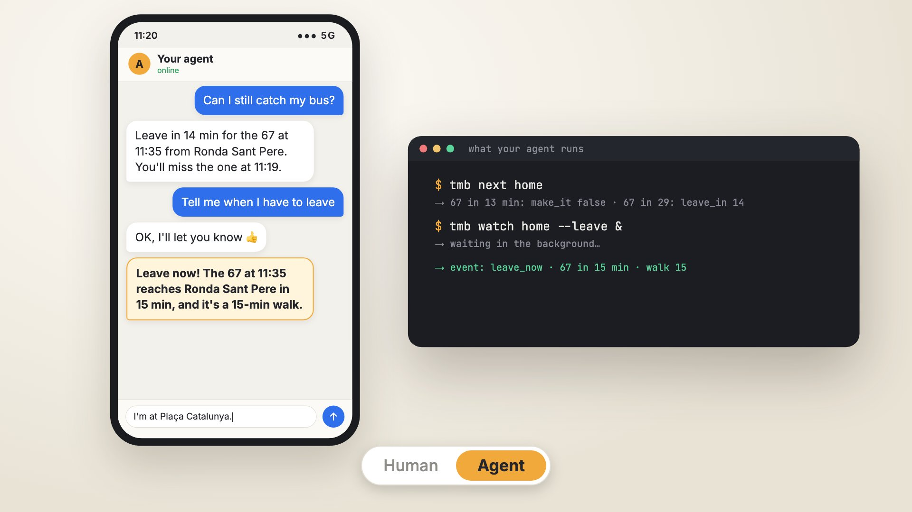

# tmb-cli

[](.github/assets/tmb-cli-demo.mp4)

<p align="center"><a href=".github/assets/tmb-cli-demo.mp4">▶ Watch the 25-second demo</a></p>

Unofficial command-line client for Barcelona's real-time bus and metro arrivals: **TMB**
(Transports Metropolitans de Barcelona: Barcelona's buses and metro) and **AMB**'s metropolitan
buses run by other operators (TUSGSAL, Moventis, Monbus, Aerobús…). Output is JSON, so shell
pipelines (`jq`), coding agents (Claude Code, Codex…) and personal agents you text from your phone
(Hermes, OpenClaw…) can use it directly.

> Not affiliated with or endorsed by TMB or AMB. Data: TMB's open API and AMB's open data,
> credited in every response (`source`, `updated_at`).

## Requirements

- Python 3.12+ and [uv](https://docs.astral.sh/uv/)
- A free TMB API key, for TMB's buses and the metro: see
  [Get your TMB keys](#get-your-tmb-keys-about-2-minutes). AMB's buses need no key.

## Install

```bash
uv tool install git+https://github.com/alegoml/tmb-cli@v0.3.0
```

Or with the script, which does the same after checking that uv is there (read it first):

```bash
curl -LsSf https://raw.githubusercontent.com/alegoml/tmb-cli/main/install.sh | sh
```

From a clone, for development:

```bash
git clone https://github.com/alegoml/tmb-cli && cd tmb-cli
uv sync
uv run tmb --help
```

## Get your TMB keys (about 2 minutes)

TMB's buses and the metro need your own free key; AMB's metropolitan buses work without one, so
you can skip this if you only use those.

1. **Sign up** at [developer.tmb.cat](https://developer.tmb.cat/) and log in.
2. **Create an application** ("Nueva aplicación"):
   - *Nombre de la aplicación*: `tmb-cli` (TMB's terms tie the key to the application you declare).
   - *Descripción*: for example `Unofficial open-source command-line client that shows real-time
     TMB bus and metro arrivals, for personal use and for coding agents. Read-only. Data credited
     to TMB.`
   - *URL de acceso*: leave it empty, or use `https://github.com/alegoml/tmb-cli` if the form
     wants one.
   - Read and accept the terms, then *Finalizar*.
3. **Save the keys** shown on the application's page, in your own terminal:

   ```bash
   tmb auth set      # asks for app_id, then app_key (hidden while you paste it)
   tmb doctor        # "api": ok means the keys work
   ```

   Copy each value on its own: if `doctor` says `auth_failed`, the usual cause is extra text
   pasted with the `app_key`. Run `tmb auth set` again.

Keep the keys to yourself, and **never paste them into an agent's chat**: that's what `tmb auth set`
is for. If your agent runs somewhere you can't open a terminal (a phone app, a cloud sandbox), use
its secrets or environment settings for `TMB_APP_ID` and `TMB_APP_KEY`, or create a second
application just for it, so you can delete that one if it leaks.

## Credentials

```bash
tmb auth set       # prompts for app_id and app_key (hidden), saved to ~/.config/tmb-cli/credentials.json (0600)
tmb auth status    # offline check; never prints the key
```

Environment variables `TMB_APP_ID` and `TMB_APP_KEY` take precedence over the file.

## Usage

Built for a personal agent you text ("¿me da tiempo a pillar el bus?", "avísame cuando le queden
5 min al 67"): one message is one call, and every answer carries `say`, a ready-to-send sentence.

```bash
tmb place add casa 41.4521,2.2410 --label "Carrer X 12"   # a place: picks its nearby stops and walk times
tmb next casa                  # what's coming and when to leave, across all of casa's stops
tmb next 67                    # the 67 at your places' stops
tmb near plaça catalunya       # stops around a place, a name or a lat,lon, with arrivals
tmb watch casa --line 67 --minutes 5   # wait, then exit when the 67 is 5 min away
tmb watch casa --leave         # wait, then exit when it's time to set off
tmb route casa "sagrada familia" --by 18:00   # up to 3 options from TMB's trip planner
tmb leave trabajo --by 9:00    # when to leave (from casa); --wait exits at that time
tmb setup                      # what's missing and the next question to ask (agents onboarding you)
tmb trip add trabajo --from casa --to trabajo --by 9:00 --days lun-vie   # then: tmb leave trabajo
tmb prefs --margin 2 --pace slow   # default spare minutes; walking pace for estimates
```

`tmb` can't see your phone's location: your agent passes a location you share (a WhatsApp or
iMessage pin) as `lat,lon`, or asks where you are. When a name matches two places ("Plaça
Catalunya" is in Barcelona and in Gavà), the answer says so and lists the alternatives.

```json
{
  "resolved": {"kind": "place", "name": "casa"},
  "stops": [{"type": "bus", "name": "Ronda Sant Pere - Pl Catalunya", "codes": ["1082"], "walk_minutes": 4}],
  "arrivals": [
    {"line": "67", "destination": "Cornellà", "minutes": 3, "eta": "2026-10-26T11:09:02+01:00", "operator": "TMB",
     "stop": "Ronda Sant Pere - Pl Catalunya", "leave_in": -1, "make_it": false},
    {"line": "67", "destination": "Cornellà", "minutes": 19, "eta": "2026-10-26T11:25:40+01:00", "operator": "TMB",
     "stop": "Ronda Sant Pere - Pl Catalunya", "leave_in": 15, "make_it": true}
  ],
  "say": "Sal en 15 min para pillar el 67 de las 11:25 en Ronda Sant Pere - Pl Catalunya. El 67 de las 11:09 ya no lo pillas.",
  "source": "TMB",
  "updated_at": "2026-10-26T11:06:14+01:00"
}
```

(Shortened.) `next` and `watch` take anything: a place, a favourite, a line, a stop code, a
`lat,lon` point or words (`resolved` says what was understood). Places live only on your machine,
in `~/.config/tmb-cli/places.json`; walk times are estimated from the distance until you set your
own with `tmb place walk casa <code> <minutes>`. `tmb` doesn't geocode: the agent turns addresses
into `lat,lon`. `watch` checks every 30 s and exits with one event (`due`, `leave_now` or
`timeout`), so an agent runs it in the background and texts you when it ends.

Lower level:

```bash
tmb bus 1103             # next buses at stop 1103 (Pl Catalunya)
tmb bus 1103 --line V15  # only the V15 (case-insensitive, repeatable)
tmb metro 126 326        # next trains at Catalunya, L1 and L3 (codes are per line)
tmb stops catalunya      # find stop and station codes by name
tmb fav add casa 1103 --walk 4   # a single stop with your walk time (places are the richer version)
```

`minutes` is rounded down (3 min 50 s shows 3) and `eta` is Barcelona time. Arrivals are the next
two per line and destination. `metro` returns `stations`, each with its `arrivals` (plus `track`)
and the station's `name` once the network is cached. Data: `source`, as of `updated_at`.

`tmb bus` covers both networks with the same stop codes: at a stop TMB and AMB share it merges
both (`"source": "TMB+AMB"`, each arrival with its `operator`); an AMB-only stop (e.g. in
Badalona) needs no TMB key. AMB's line names come from its GTFS, cached in
`~/.cache/tmb-cli/amb.json` (a ~9 MB download the first time and every few days, when AMB
republishes it).

`tmb stops <words>` searches bus stops and metro stations by name, street or town, ignoring case
and accents (no quotes needed), in TMB's and AMB's networks (`"network": "TMB"` or `"AMB"`). A metro
station lists one code per line (`"codes": {"L1": "126", "L3": "326"}`): pass them all to
`tmb metro`. The first run downloads the static network (13 requests) to
`~/.cache/tmb-cli/network.json`; it refreshes weekly, or now with `--refresh`.

`leave_in` is minutes until you must set off (`minutes` minus your walk time) and `make_it` is
`leave_in` ≥ `--margin` (0 by default). Favourites live in `~/.config/tmb-cli/favourites.json`; a
metro favourite can hold every line of an interchange: `tmb fav add feina 126 326 --metro --walk 5`.

Errors are printed to stderr as one line of JSON, with stable exit codes:

```json
{"error": {"code": "rate_limited", "message": "…", "exit_code": 5, "retryable": true, "hint": "…"}}
```

| Exit code | `code` | Meaning |
|---|---|---|
| 0 | | OK |
| 1 | `internal` | Unexpected error (only the exception type is reported) |
| 2 | `usage` | Bad usage, cancelled prompt, or a prompt was needed under `--no-input` |
| 3 | `missing_credentials`, `auth_failed` | Missing, unreadable or rejected credentials |
| 4 | `not_found` | Unknown stop or station |
| 5 | `api_error`, `rate_limited` | TMB API error or rate limit |
| 6 | `network_error` | Network failure or timeout |
| 7 | `api_changed` | Unexpected response shape: the TMB API probably changed |
| 130 | `interrupted` | Interrupted (Ctrl-C) |

`retryable: true` means trying again later may work (rate limit, TMB 5xx, network); `false` means
retrying won't help until something changes.

Argument errors caught by the parser itself (a missing stop code, an unknown option) are still
printed as plain text, with exit code 2.

Scripts and agents should pass `--no-input` (anywhere: `tmb --no-input bus 1103` and
`tmb bus 1103 --no-input` both work) or set `TMB_NO_INPUT=1`, so the CLI never waits for a prompt.

## Using it from a coding agent

The point of `tmb` is that your agent (Claude Code, Codex, …) can answer "¿me da tiempo a pillar
el V15?" without ever seeing your TMB keys, and remembers your stop and how long you take to get
there.

1. **You** set the keys once, in your own terminal (not through the agent): `tmb auth set`.
2. Give your agent the guide. It ships with the CLI:
   ```bash
   tmb skills get                                   # print it
   mkdir -p ~/.claude/skills/tmb && tmb skills get > ~/.claude/skills/tmb/SKILL.md   # Claude Code
   ```
   For other agents, point them at `tmb skills get` or paste it into their instructions
   (`AGENTS.md`).
3. The first time, the agent runs `tmb setup` and asks what it needs, one thing at a time: your
   home and other places (it picks the stops and walk times; you correct them), usual trips (and
   whether you want a daily "sal ya" for them), your margin and walking pace. Then just text it:
   "¿me da tiempo a pillar el bus?", "¿cuándo pasa el 67?", "estoy en Plaça Catalunya, ¿qué pasa?",
   "avísame cuando tenga que salir".

It works with coding agents (Claude Code, Codex…) and with personal agents you message that can
run commands (Hermes, OpenClaw, a phone agent with a terminal…).

Why a CLI and not raw `curl` against the API: the keys stay out of the agent's context (and out of
its logs), stop names resolve to codes (`tmb stops`), the output is compact (a fraction of the raw
payload's tokens), favourites and walk times persist between sessions, and failures come as typed
JSON with exit codes the agent can act on. `tmb doctor` checks the keys, API access, the stops
cache and the favourites file in one call.

## Development

```bash
uv run pytest
uv run ruff check . && uv run ruff format --check .
```

Tests never call the real API (they use `httpx.MockTransport`).

## Data and attribution

Data:

- **Transports Metropolitans de Barcelona (TMB)**, from its open developer API
  ([developer.tmb.cat](https://developer.tmb.cat/)), under TMB's
  [terms of use](https://developer.tmb.cat/docs/terms-conditions).
- **Àrea Metropolitana de Barcelona (AMB)**, from its open data (GTFS and GTFS-Realtime of the
  metropolitan buses, publisher AMB Informació), under AMB's
  [terms of use](https://www.amb.cat/web/area-metropolitana/dades-obertes/condicions-d-us)
  (Llei 37/2007).

Both ask to cite the source together with the date of the last update, and not to alter the data.
`tmb` does that in every response: `source` (`"TMB"`, `"AMB"` or `"TMB+AMB"`) and `updated_at`
(the source's own time for real time, the older one when there are two; the dataset dates for the
stops list). `minutes`, `leave_in` and `make_it` are computed from the sources' times; names,
lines and destinations are passed through as published.

Each user gets their own TMB key and accepts TMB's terms. Register the application as `tmb-cli`. TMB
may change the API or its terms without notice; if a response stops matching, `tmb` fails with
`api_changed` (exit 7) instead of guessing.

## Disclaimer

This project is not affiliated with or endorsed by Transports Metropolitans de Barcelona or the
Àrea Metropolitana de Barcelona. It uses TMB's public developer API with your own credentials and
AMB's open data; you are responsible for complying with their terms of use.

## License

[MIT](LICENSE)
